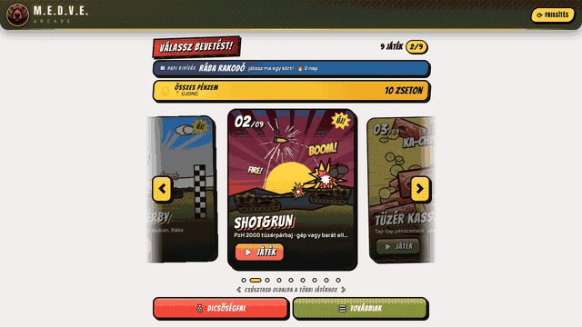
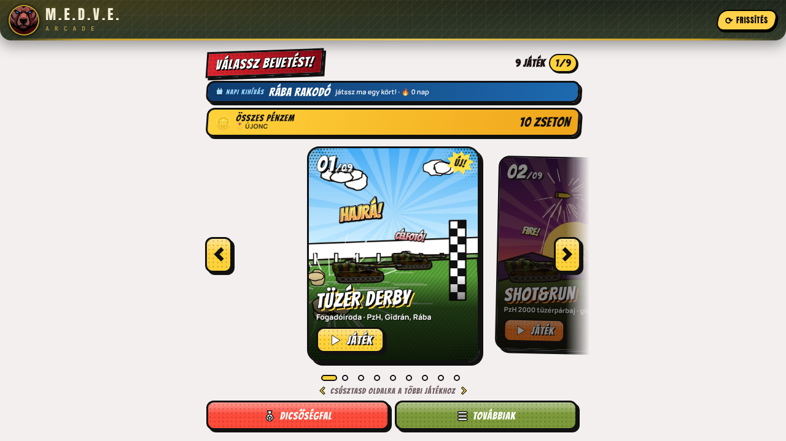
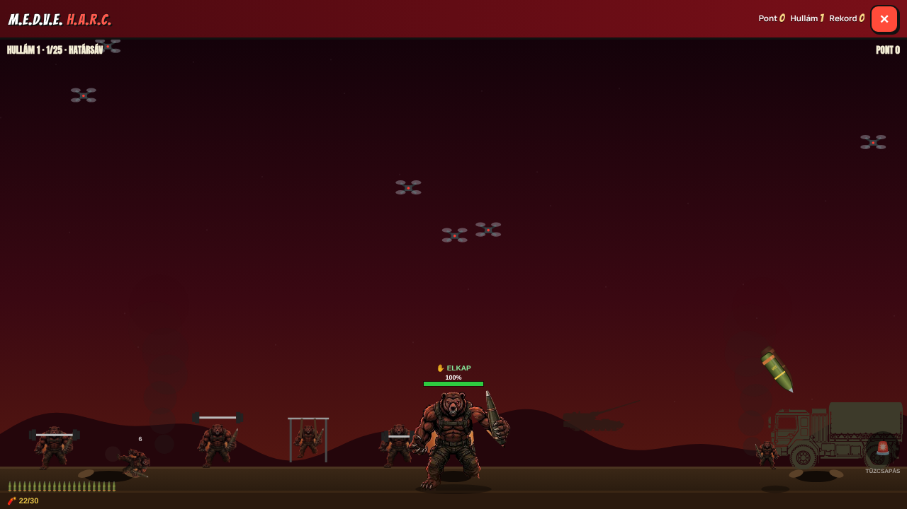

🇬🇧 English · [🇭🇺 Magyar](README.hu.md)

# M.E.D.V.E. Arcade

**A collection of nine military-themed mini-games that runs in your browser and installs as an app, with live leaderboards and chat.**

<p align="center"></p>

<p align="center">
  <a href="https://medvearcade.vercel.app/"><b>▶ Play now</b></a>
</p>

[](LICENSE)
[](https://github.com/strattila90-hue/M.-E.-D.-V.-E.-ARCADE/commits/main)


> The game UI is in Hungarian.

## Features

- **9 mini-games** in one installable app: M.E.D.V.E. H.A.R.C. (grenade-storm defence with waves and bosses), Meat Grinder (post-apocalyptic drive-to-the-end game: plough a PzH 2000 through zombie hordes and upgrade it in the workshop), Gidrán Terep (4x4 off-road with tyre pressure, cruise control and an expedition mode), Gidrán Konvoj, Rába Rakodó (tower stacking), SERE Kitörés (survival and evasion), Tüzér Kassza (tap-tap idle game), Shot&Run (artillery duel) and Tüzér Derby (betting on races).
- **Live leaderboard and chat** (Firebase, nickname and password only; works without an account, records then stay on the device).
- **Hall of Fame** with rank medals across all games, and an in-game chip wallet.
- **Installable PWA:** offline cache, in-app update button, install guide for Android and iPhone.
- **Sound and music**, volume control, low-end phone mode for smoother play.
- **Share by link or QR code** (the QR encoder is built in, no network needed).

## Screenshots

| Main menu | M.E.D.V.E. H.A.R.C. |
|---|---|
|  |  |

## How to run locally

No build step, no package manager. Serve the folder over HTTP (the service worker does not work from `file://`):

```bash
git clone https://github.com/strattila90-hue/M.-E.-D.-V.-E.-ARCADE.git
cd M.-E.-D.-V.-E.-ARCADE
python3 -m http.server 8080
# open http://localhost:8080
```

Leaderboard and chat need your own Firebase project; without one, everything else works and records are stored locally. Setup steps (in Hungarian) are in [README.hu.md](README.hu.md#firebase-beállítása-egyszer-kb-10-perc).

## Tech

- Vanilla JavaScript (ES modules), HTML5 canvas, Web Audio, CSS; no framework, no bundler.
- PWA: web manifest and a service worker with an offline cache.
- Firebase (Auth + Firestore) for leaderboards and chat; security rules in `firestore.rules`, rule tests in `tests/`.
- Deployed on Vercel (see `vercel.json` for the security headers).

## Contributing

Contributions are welcome, see [CONTRIBUTING.md](CONTRIBUTING.md). Good first issues are labelled `good first issue`.

## License

[MIT](LICENSE) © 2026 strattila90-hue

---

⭐ If you like it, please give it a star — it really helps!
